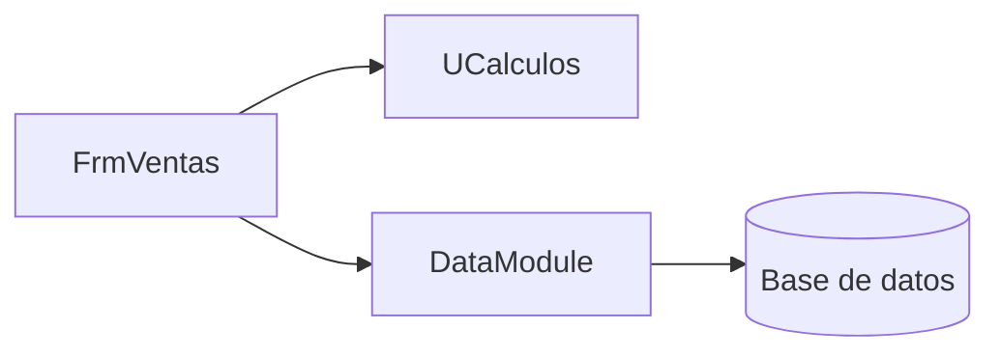
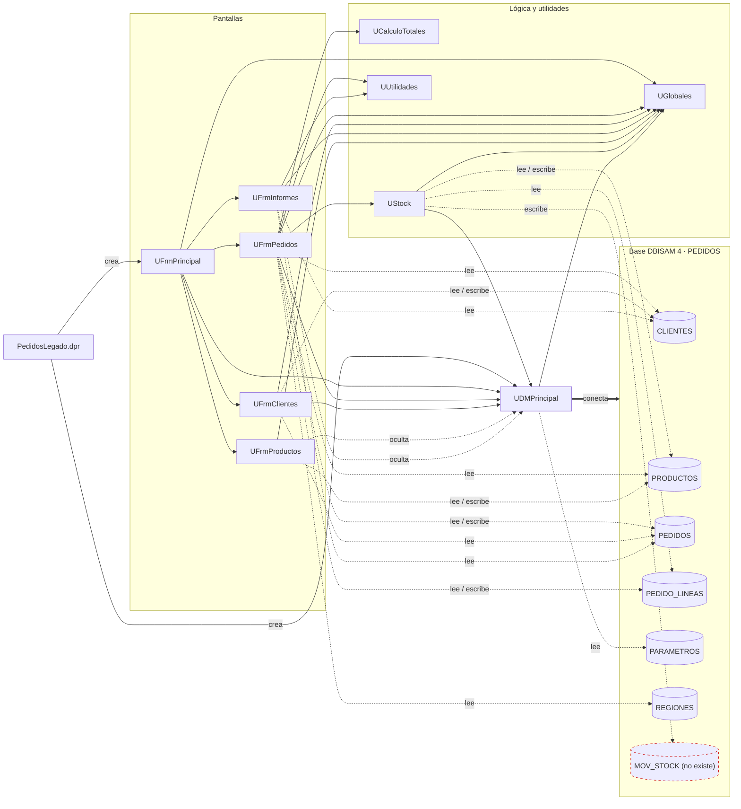

# Dependencias de Pedidos Legado

<!--
Etapa 1 · Entender (plan mode).
Dibuja quién usa a quién: unidades, formularios y la base de datos.
- Una flecha A --> B significa «A usa a B» (lo ves en la cláusula uses o en una consulta SQL).
- Incluye la base de datos (DBISAM) como un nodo: es parte del sistema.
Punto de control E1: el diagrama incluye la base de datos.

Ejemplo genérico (de otro sistema, no de este):

-->

**Cómo leerlo**

- Flecha continua `A --> B`: A tiene a B en su cláusula `uses`.
- Flecha punteada `A -.-> tabla`: A arma la consulta SQL o tiene el componente que lee o escribe esa tabla, aunque la ejecute con las consultas compartidas del data module.
- Flecha punteada `A -.-> UDMPrincipal` con la etiqueta «oculta»: A no declara al data module, pero sus componentes usan la base `PEDIDOS` que el data module crea. Si el data module no se conecta, esas pantallas fallan.
- `PedidosLegado.dpr` registra todas las unidades; en el diagrama solo se dibuja lo que crea al arrancar.

Evidencia de las flechas: cláusulas `uses` de cada `.pas` y las consultas citadas en la tabla «Tablas de la base» de `inventario.md`. Dependencias ocultas: `DatabaseName = 'PEDIDOS'` en `UFrmProductos.dfm:87` y `UFrmInformes.dfm:150`, sin `UDMPrincipal` en sus `uses` (`UFrmProductos.pas:35-36`, `UFrmInformes.pas:45-46`).

## Preguntas guía

1. **¿Qué unidad usan casi todas las demás? ¿Qué pasaría si cambia?**
   `UGlobales`: la usan 7 unidades (las 5 pantallas, `UStock` y `UDMPrincipal`). Guarda el usuario y su nivel, la tasa de IVA, el flete por defecto y la ruta de datos, y varias pantallas la modifican (`UGlobales.pas:3-4`). Un cambio ahí afecta permisos, cálculos de totales y la conexión a la base al mismo tiempo, y no hay forma de saber quién cambió un valor.

2. **¿Qué unidad no depende de formularios ni de la base de datos? ¿Por qué eso importa para migrar?**
   `UCalculoTotales` y `UUtilidades`: solo usan `SysUtils` y `DateUtils`. Se pueden traducir a C# y cubrir con tests xUnit sin levantar pantallas ni base, así que son buenas candidatas para migrar primero. Ojo: el total que se graba no sale de `UCalculoTotales`, sino del recálculo dentro de `UFrmPedidos` (ver «Lo que me llamó la atención» en `inventario.md`); migrar solo `UCalculoTotales` no reproduce lo que hoy queda en la base.
