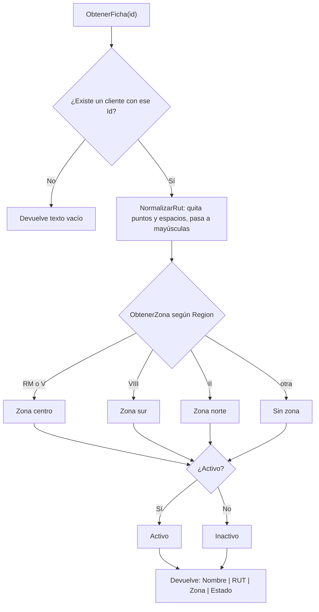

# ClientesService

Archivo: `src/PedidosWeb.Core/Clientes/ClientesService.cs`
Tests: `tests/PedidosWeb.Core.Tests/Clientes/ClientesServiceTests.cs` (9 casos)

## Propósito

Responde dos preguntas sobre un cliente de la distribuidora, a partir de su código (`C-001`, `C-002`, …):

- **¿Qué muestro en pantalla?** Una ficha de una línea con nombre, RUT, zona y estado.
- **¿Está activo?** Sí o no.

Es un módulo heredado. En la Unidad 3 se ordenó sin cambiar su comportamiento: los tests de caracterización fijan lo que hacía antes.

## API pública

| Miembro | Qué hace |
|---|---|
| `ClientesService()` | Usa los 8 clientes de `ClientesDeEjemplo.Crear()`. |
| `ClientesService(List<Cliente> clientes)` | Usa la lista que le pases. |
| `string ObtenerFicha(string id)` | Devuelve `Nombre \| RUT \| Zona \| Estado`. Si el cliente no existe, devuelve `""` (texto vacío, no `null` ni excepción). |
| `bool EstaActivo(string id)` | `true` si el cliente existe y está activo. `false` si está inactivo **o** no existe. |

### Cómo arma la ficha

- **RUT:** le quita los puntos y los espacios y lo pasa a mayúsculas. `76.990.011-k` → `76990011-K`; `76 432 198-7` → `76432198-7`. No valida el dígito verificador.
- **Zona,** según `Cliente.Region`:

  | Región | Zona |
  |---|---|
  | `RM`, `V` | Zona centro |
  | `VIII` | Zona sur |
  | `II` | Zona norte |
  | cualquier otra | Sin zona |

- **Estado:** `Activo` o `Inactivo`, según `Cliente.Activo`.

## Ejemplo de uso

```csharp
using PedidosWeb.Core.Clientes;

var servicio = new ClientesService(); // los 8 clientes de ejemplo

servicio.ObtenerFicha("C-001");
// "Ferretería El Clavo | 76123456-0 | Zona centro | Activo"

servicio.ObtenerFicha("C-007");
// "Kiosco Central | 77321654-1 | Zona sur | Inactivo"

servicio.ObtenerFicha("C-999");  // ""
servicio.EstaActivo("C-001");    // true
servicio.EstaActivo("C-007");    // false (inactivo)
servicio.EstaActivo("C-999");    // false (no existe)
```

Cada salida coincide con un test de `ClientesServiceTests`.

## Diagrama

Flujo de `ObtenerFicha`:



## Preguntas abiertas

Hoy el código hace lo que se describe abajo, pero no hay una regla de negocio escrita que lo respalde. Hay que confirmarlo con el negocio antes de cambiarlo.

1. **Regiones sin zona.** Solo `RM`, `V`, `VIII` y `II` tienen zona. ¿Las otras regiones de Chile deben quedar en "Sin zona" o falta agregarlas?
2. **Mayúsculas en la región y el código.** La comparación distingue mayúsculas: `rm` da "Sin zona" y `c-001` no encuentra al cliente. ¿Es intencional?
3. **Cliente inexistente.** `ObtenerFicha` devuelve `""` y `EstaActivo` devuelve `false`. Quien llama no puede distinguir entre "no existe" e "inactivo" usando solo `EstaActivo`. ¿La pantalla necesita esa diferencia?
4. **RUT inválido o nulo.** No se valida el dígito verificador. Un `Rut` en `null` provoca una excepción. ¿Basta con normalizar o hay que validar?
5. **Mayúsculas según la configuración regional.** `ToUpper()` usa la configuración regional del equipo. Con los RUT chilenos no hay diferencia, pero conviene decidir si se fija una configuración (`ToUpperInvariant`). Hacerlo sería un cambio de comportamiento con su propio test.
